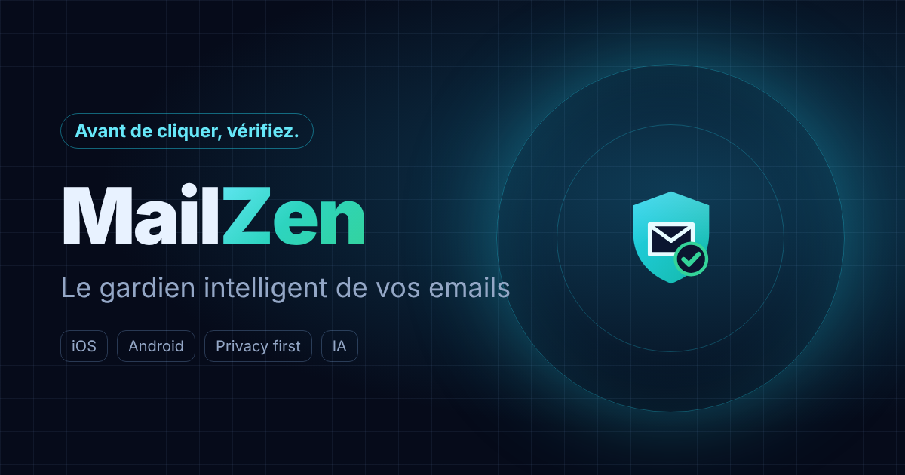

<div align="center">

[](https://maxlestage.github.io/MAILZEN/)

# 🛡️ MailZen

**Le gardien intelligent de vos emails. Avant de cliquer, vérifiez.**

**Français** · [English](README.en.md) · [Español](README.es.md)

[Site (GitHub Pages)](https://maxlestage.github.io/MAILZEN/) · [Déployer sur Heroku](https://heroku.com/deploy?template=https://github.com/maxlestage/MAILZEN)

</div>

---

MailZen est une application mobile de protection numérique (iOS en Swift / SwiftUI,
Android en Kotlin / Compose, moteur d’analyse commun en Rust) qui aide chacun à
reconnaître, comprendre et éviter les emails malveillants, le phishing, les liens
dangereux, les pièces jointes suspectes et les arnaques.

Ce dépôt contient **le site de présentation**, écrit **uniquement en Rust** avec le
framework [Paquets](https://github.com/maxlestage/Paquets) :

| | |
|---|---|
| 🦀 **100 % Rust** | Le serveur est une `paquets::App`, les pages sont des vues Active rendues par le serveur, les parties interactives sont des îlots compilés en WebAssembly. |
| 📱 **Mobile first** | Conçu d’abord pour les téléphones, sans aucun défilement horizontal (vérifié de 320 px à 1440 px). |
| ✨ **Animé** | Préchargement, radar et réseau dessinés en 2D (canvas, en Rust), apparitions au défilement, compteurs, curseur, boutons magnétiques, cartes inclinées, ondes, marquees… Tout se coupe avec « réduire les animations ». |
| 🧪 **Démo réelle** | Un petit moteur de règles en Rust analyse dans le navigateur le message que vous collez : expéditeur, liens, pièces jointes, techniques de manipulation. Rien n’est envoyé. |
| 🌍 **Trois langues** | Français, anglais, espagnol (`/fr/`, `/en/`, `/es/`), avec `hreflang`, sitemap et choix automatique de la langue. Une traduction manquante ne compile pas. |
| 📲 **PWA** | Installable sur l’écran d’accueil, consultable hors ligne (manifeste par langue, service worker, icônes). |
| 🔒 **Sans traceur** | Aucun cookie, aucune police externe, aucune mesure d’audience ; une CSP stricte sur chaque page. |

## Sections du site

Accueil animé · modules (Mail Scanner, Link Guard, Attachment Guard, ScreenScan, QR
Guard, ZenAI, SOS Cyber) · déroulé d’un scan · **démo interactive** · rapport de
sécurité et verdicts · Sender Intelligence · Link Guard · Attachment Guard · ScreenScan
et QR Guard · ZenAI · détection de la manipulation · bibliothèque d’arnaques · **SOS
Cyber interactif** · écosystème (Safe Reply, Brand Check, FamilyZen, ZenLearn) ·
tableau de bord Radar · **quiz « vrai ou faux lien »** · PrivacyZen · architecture ·
contraintes iOS / Android · feuille de route · **tarifs (mensuel / annuel)** · FAQ ·
pied de page complet. Plus les pages « Confidentialité du site », « Mentions légales »
et 404, dans les trois langues.

## Tout depuis un téléphone

1. **Fusion automatique** : chaque push sur une branche lance la [CI](.github/workflows/ci.yml)
   (formatage, clippy serveur et WebAssembly, tests, bundle, export statique). Quand
   tout est vert, la branche est **fusionnée automatiquement dans `master`** (sauf les
   branches `wip/...`), puis GitHub Pages et Heroku sont déployés.
2. **GitHub Pages** (une seule fois) : GitHub → *Settings* → *Pages* → *Build and
   deployment* → *Source* : **GitHub Actions**. Le workflow
   [`pages.yml`](.github/workflows/pages.yml) publie ensuite chaque version de `master`
   sur <https://maxlestage.github.io/MAILZEN/>.
3. **Heroku** avec le buildpack [emk/rust](https://elements.heroku.com/buildpacks/emk/heroku-buildpack-rust)
   sur la pile heroku-26 ([`RustConfig`](RustConfig), [`heroku-build.sh`](heroku-build.sh),
   [`Procfile`](Procfile), [`app.json`](app.json)) :
   - en un appui : [Deploy to Heroku](https://heroku.com/deploy?template=https://github.com/maxlestage/MAILZEN) ;
   - ou automatiquement après chaque fusion : dans GitHub, *Settings → Secrets and
     variables → Actions*, ajoutez le secret `HEROKU_API_KEY` (Heroku → *Account
     settings* → *API Key*) et la variable `HEROKU_APP_NAME`.
     [`heroku.yml`](.github/workflows/heroku.yml) utilise l’API Heroku, sans CLI.

## Développement

```sh
./build-wasm.sh                  # îlots et animations → pkg/
cargo run --release              # http://localhost:3000 (PORT sur Heroku)
BASE_PATH=/MAILZEN cargo run --release -- export dist   # le site statique (GitHub Pages)
cargo fmt --check && cargo clippy --all-targets -- -D warnings && cargo test
```

| Dossier | Contenu |
|---|---|
| `src/server/` | le serveur Paquets, les pages, l’export statique |
| `src/islands.rs` | les îlots : démo d’analyse, SOS Cyber, quiz, tarifs, retour en haut |
| `src/engine.rs` | le moteur de règles de la démo |
| `src/client/` | le code du navigateur (WebAssembly) : animations et canvas 2D |
| `src/data.rs`, `src/i18n.rs` | les textes, en français, anglais et espagnol |
| `public/` | la feuille de style, le logo, les icônes de la PWA, l’image de partage |

## L’app iOS (Swift, SwiftUI)

Dans [`apps/ios/`](apps/ios) :

| | |
|---|---|
| **MailZenKit** | le cœur en Swift pur, testé (`swift test`) : moteur d’analyse, lecture des emails (.eml, MIME, SPF/DKIM/DMARC), Attachment Guard (type réel, SHA-256, PDF, Office, ZIP, HTML, SVG, CSV), client IMAP, Brand Check, ZenAI, Safe Reply, contenu en trois langues |
| **App** | accueil avec radar animé, scanner (texte, fichier ou pièce jointe, capture lue par OCR, QR code en direct, lien), rapport, ZenAI, Safe Reply, historique local, Apprendre, Brand Check, SOS Cyber, réglages |
| **Veille** | connexion à une boîte iCloud, Gmail, Yahoo ou IMAP (mot de passe pour app, dans le trousseau), vérification en arrière-plan et notification si un email dangereux arrive |
| **Extension** | « Partager → MailZen » depuis Mail, Safari, Photos ou Fichiers |
| **Modèles** | quatre modèles entraînés ([`ml/`](ml), [fiche](ml/MODEL_CARD.md)) qui tournent sur l’iPhone : arnaques, familles d’arnaques, liens de phishing, questions à ZenAI. Autonomes : le modèle décide seul quand il est sûr, et il **apprend de vos corrections sur l’appareil**, sans serveur. La démo du site utilise les mêmes, en Rust/WebAssembly |

Le projet Xcode est généré par [XcodeGen](apps/ios/project.yml) : la CI compile l’app sur un Mac de
GitHub à chaque push. Pour l’installer sur un iPhone via TestFlight, sans ordinateur : voir
[`ios-release.yml`](.github/workflows/ios-release.yml) (compte Apple Developer et clé App Store Connect).

## Licence

© 2026 Maxime Nathan Lestage, tous droits réservés. Voir [LICENSE](LICENSE).
